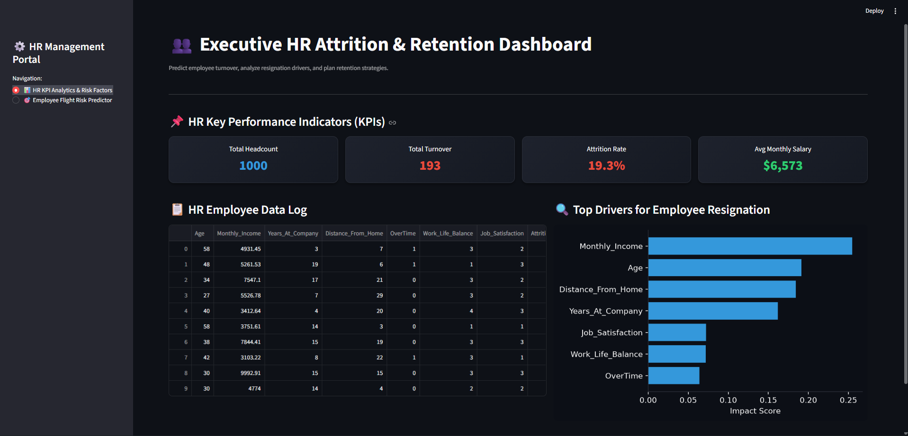
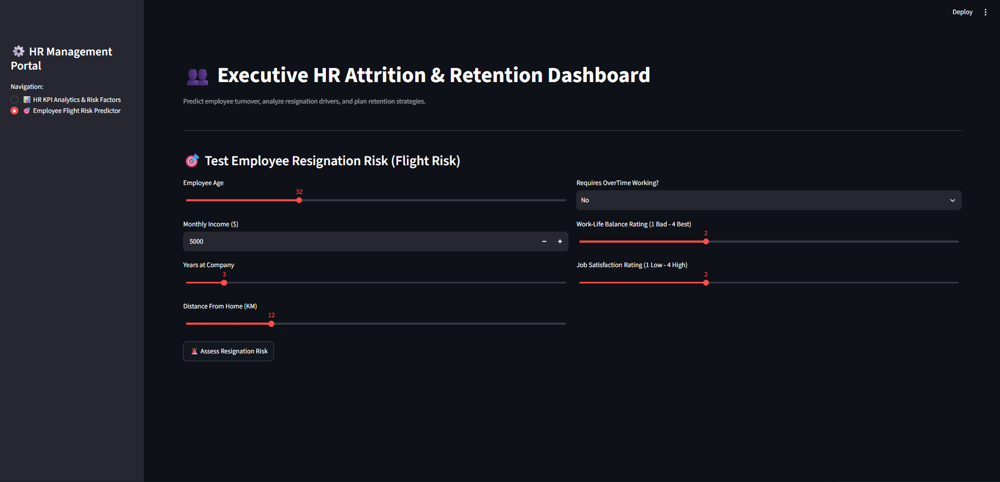

# 📊 Employee Attrition Analysis & Flight Risk Predictor

This project analyzes HR data to identify key drivers of employee attrition and provides an interactive Streamlit application to predict employee flight risk.

## 📌 Project Overview
Employee attrition is a critical challenge for organizations. This repository contains:
1. **HR KPI Analytics & Risk Factors Dashboard:** Visual insights into churn rates, department-wise trends, and key drivers.
2. **Employee Flight Risk Predictor App:** An interactive ML-powered tool to predict whether an employee is likely to leave based on historical data.

---

## 🖼️ Dashboard & Application Preview

### 1. HR KPI Analytics & Risk Factors


### 2. Employee Flight Risk Predictor


---

## ✨ Features
- **Exploratory Data Analysis (EDA):** Visualized key factors such as salary hike, work-life balance, experience, and job satisfaction.
- **Attrition Risk Prediction:** Machine Learning model deployed using **Streamlit** for real-time predictions.
- **Interactive Metrics:** Easy-to-use inputs for HR professionals to assess flight risks.

---

## 🛠️ Tech Stack & Tools
- **Python** (Pandas, NumPy, Scikit-Learn)
- **Streamlit** (Web App Framework)
- **Matplotlib / Seaborn** (Data Visualization)

---

## 🚀 How to Run Locally

1. **Clone the repository:**
   ```bash
   git clone [https://github.com/vishal-jadhav876/Employee-Attrition-Analysis.git](https://github.com/vishal-jadhav876/Employee-Attrition-Analysis.git)
   cd Employee-Attrition-Analysis
